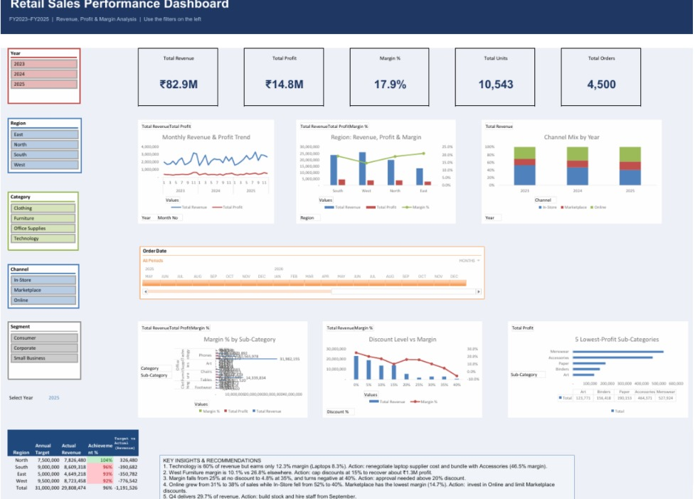

# Retail Sales Performance Dashboard (Excel)

An interactive Excel dashboard built with PivotTables, PivotCharts, slicers
and GETPIVOTDATA KPI cards to help management decide on pricing,
discounting and seasonal planning.

## Business Questions
- Which regions and categories drive profit, and which only drive revenue?
- Are discounts destroying margin?
- Which sub-categories should be expanded, repriced or phased out?
- How is the channel mix shifting?
- How should we plan for the Oct–Dec peak?

## Tools
Microsoft Excel: PivotTables, PivotCharts, Slicers, GETPIVOTDATA,
SUMIFS, INDEX/MATCH, Conditional Formatting, Calculated Fields

## Key Insights
- Technology is 60% of revenue but earns only 12.3% margin (Laptops 8.3%).
- West Furniture margin is 10.1% vs 26.8% elsewhere (about ₹1.3M profit gap).
- Margin drops from 25% (no discount) to 4.8% (35% discount) and turns negative at 40%.
- Online grew from 31% to 38% of sales; Marketplace has the lowest margin (14.7%).
- Q4 delivers 29.7% of revenue, so plan stock and staff from September.

## Recommendations
1. Renegotiate laptop supplier cost and bundle with accessories.
2. Cap discounts at 15%; require approval above 20%.
3. Reprice Tables and review West furniture pricing.
4. Invest in Online and limit Marketplace discounts.
5. Build Q4 inventory and hire seasonal staff from September.

## Files
- `Retail_Sales_Dashboard.xlsx`: the dashboard (open in desktop Excel for slicers)
- `dashboard.png`: screenshot

## Data
Synthetic data of 4,500 retail orders (FY2023–FY2025), created for portfolio practice.
