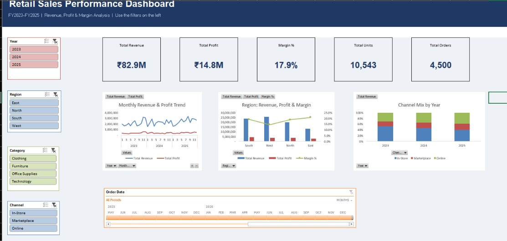

# Retail Sales Performance & Profitability Dashboard (Excel)

**An interactive Excel dashboard built with PivotTables, PivotCharts, Slicers and GETPIVOTDATA KPI cards to support decisions on pricing, discounting, product mix and seasonal planning.**


*Filtered view (West region selected), showing that every KPI and chart responds to the slicers:*



---

## Table of Contents
1. [Project Overview](#1-project-overview)
2. [Business Problem & Decision Questions](#2-business-problem--decision-questions)
3. [Tools & Skills Used](#3-tools--skills-used)
4. [Dataset](#4-dataset)
5. [Methodology: Step by Step](#5-methodology-step-by-step)
6. [Dashboard Design](#6-dashboard-design)
7. [Key Insights](#7-key-insights)
8. [Recommendations](#8-recommendations)
9. [How to Use the Dashboard](#9-how-to-use-the-dashboard)
10. [How to Recreate This Project](#10-how-to-recreate-this-project)
11. [Challenges & Learnings](#11-challenges--learnings)
12. [Future Improvements](#12-future-improvements)
13. [Repository Structure](#13-repository-structure)
14. [About the Author](#14-about-the-author)

---

## 1. Project Overview

A multi-category retailer operates **12 stores across 4 regions** and sells through **3 channels** (In-Store, Online, Marketplace). Revenue is growing, but leadership cannot see **where profit is actually made or lost**.

This project turns **4,500 order records (FY2023-FY2025)** into a one-page, interactive dashboard that lets a manager filter by year, region, category, channel and segment, and immediately see the effect on revenue, profit, margin, discounting, channel mix and target achievement.

**Headline result:** Technology brings 60% of revenue but only a 12.3% margin; discounts above 15% sharply erode profit; West-region furniture is the single largest margin leak (about ₹1.3M profit gap).

---

## 2. Business Problem & Decision Questions

The dashboard was designed to answer five decision questions:

| # | Decision question | Where it is answered |
|---|---|---|
| 1 | Which regions and categories drive **profit**, not just revenue? | Region chart, Sub-Category margin chart |
| 2 | Is **discounting** destroying margin, and where should it be capped? | Discount vs Margin chart |
| 3 | Which sub-categories should be **expanded, repriced or phased out**? | Sub-Category margin chart, Bottom-5 profit chart |
| 4 | How is the **channel mix** shifting, and what does it do to profitability? | Channel Mix chart |
| 5 | How should we plan **inventory and staffing** for the Oct-Dec peak? | Monthly trend chart |

An additional **Target vs Actual** table checks whether each region is meeting its annual revenue target.

---

## 3. Tools & Skills Used

| Area | Details |
|---|---|
| Software | Microsoft Excel (desktop) |
| Data structuring | Excel Tables (`tblSales`), structured references |
| Analysis | PivotTables (9 pivots), Calculated Fields, Value Filters (Top/Bottom 5), Show Values As (% of total) |
| Formulas | `SUMIFS`, `INDEX` / `MATCH`, `IF`, `YEAR`, `MONTH`, `TEXT`, `ROUNDUP`, `GETPIVOTDATA` |
| Visualisation | PivotCharts (line, combo with secondary axis, clustered bar, 100% stacked column) |
| Interactivity | Slicers (Year, Region, Category, Channel, Segment), Report Connections |
| Dashboard design | KPI cards, conditional formatting, data validation drop-down, consistent colour palette, text box insights |

---

## 4. Dataset

- **Source:** Synthetic retail data created for portfolio practice (no real company data).
- **Size:** 4,500 orders, Jan 2023 to Dec 2025.
- **Structure:** 4 regions, 12 states/stores, 4 categories, 15 sub-categories, 3 segments, 3 channels.
- **Currency:** Indian Rupees (₹).

> **Data note:** because the data is synthetic, patterns such as heavy West-region furniture discounting, low Table margins, Marketplace discounting, high Clothing returns and a Q4 seasonal spike were deliberately built in so the dashboard has real decisions to uncover. The analysis method is the same one used on real company data.

### Columns

| Column | Type | Description |
|---|---|---|
| Order ID | Input | Unique order number |
| Order Date | Input | Date of order |
| Year | Formula | `=YEAR([Order Date])` |
| Month No | Formula | `=MONTH([Order Date])` (keeps months in correct order) |
| Month | Formula | `=TEXT([Order Date],"mmm")` |
| Quarter | Formula | `="Q"&ROUNDUP([Month No]/3,0)` |
| Region, State, Store | Input | Location hierarchy |
| Category, Sub-Category | Input | Product hierarchy |
| Segment | Input | Consumer / Corporate / Small Business |
| Channel | Input | In-Store / Online / Marketplace |
| Units | Input | Quantity sold |
| List Price | Input | Price per unit before discount |
| Discount % | Input | Discount given on the order |
| Unit Cost | Input | Cost per unit |
| **Revenue** | Formula | `Units × List Price × (1 − Discount %)` |
| **Cost** | Formula | `Units × Unit Cost` |
| **Profit** | Formula | `Revenue − Cost` |
| **Profit Margin %** | Formula | `Profit ÷ Revenue` |
| Returned | Input | Yes / No |

A second sheet, **Targets**, holds the annual revenue target per region (inputs in blue):

| Region | Annual Revenue Target (₹) | Target Margin |
|---|---|---|
| North | 7,500,000 | 20% |
| South | 9,000,000 | 20% |
| East | 5,000,000 | 20% |
| West | 9,500,000 | 20% |

---

## 5. Methodology: Step by Step

### Step 1: Prepare the data
1. Opened the dataset in Excel and confirmed it is formatted as an **Excel Table** named `tblSales`, so pivots and formulas always include new rows automatically.
2. Added **calculated columns** (Year, Month No, Month, Quarter, Revenue, Cost, Profit, Profit Margin %) as formulas, never as hard-coded values.
3. Formatted dates, currency and percentages, and froze the header row.
4. Checked for blanks and formula errors (none found).

### Step 2: Build the PivotTables
Created a sheet named `Pivots` and built nine PivotTables from `tblSales`. A **calculated field** `Margin Pct = Profit / Revenue` was added so margin is always calculated on totals and not averaged.

| Pivot | Name | Rows / Columns | Values | Purpose |
|---|---|---|---|---|
| P1 | `P1_KPI` | none | Revenue, Profit, Units, Margin Pct, Order count | Headline KPIs |
| P2 | `P2_Trend` | Rows: Year > Month No | Revenue, Profit | Monthly trend and seasonality |
| P3 | `P3_Region` | Rows: Region | Revenue, Profit, Margin Pct | Regional performance |
| P4 | `P4_Category` | Rows: Category > Sub-Category | Revenue, Profit, Margin Pct | Product profitability (sorted by margin) |
| P4b | `P4_Chart` | Rows: Category > Sub-Category | Margin Pct | Chart-only copy of P4 |
| P5 | `P5_Channel` | Rows: Year, Columns: Channel | Revenue shown as % of row total | Channel mix over time |
| P6 | `P6_Discount` | Rows: Discount % | Revenue, Margin Pct | Discount impact on margin |
| P7a | `P7a_Top5` | Rows: Sub-Category | Profit (Top 5 value filter) | Best sub-categories |
| P7b | `P7b_Bottom5` | Rows: Sub-Category | Profit (Bottom 5 value filter) | Weakest sub-categories |
| P8 | `P8_Returns` | Rows: Category, Columns: Returned | Order count as % of row total | Return rate by category |

All pivots were given clear names so slicers can be connected to each one.

### Step 3: Target vs Actual table
Built a table with a **Year selector** (data-validation drop-down: 2023, 2024, 2025) and these formulas:

| Column | Formula |
|---|---|
| Annual Target | `=INDEX(Targets!$B$2:$B$5,MATCH(A25,Targets!$A$2:$A$5,0))` |
| Actual Revenue | `=SUMIFS(tblSales[Revenue],tblSales[Region],A25,tblSales[Year],$B$22)` |
| Achievement % | `=IF(B25=0,0,C25/B25)` |
| Gap | `=C25-B25` |

Conditional formatting colours Achievement % **green when ≥ 100%** and **red when < 100%**.

**FY2025 result:** North 104%, South 96%, East 93%, West 92%, Total 96% (₹29.8M actual vs ₹31.0M target).

### Step 4: Create the PivotCharts

| # | Source pivot | Chart type | Chart title |
|---|---|---|---|
| C1 | P2 | Line | Monthly Revenue & Profit Trend |
| C2 | P3 | Combo (columns + margin line on secondary axis) | Region: Revenue, Profit & Margin |
| C3 | P4_Chart | Clustered bar | Margin % by Sub-Category |
| C4 | P5 | 100% stacked column | Channel Mix by Year |
| C5 | P6 | Combo (revenue columns + margin line on secondary axis) | Discount Level vs Margin |
| C6 | P7b | Clustered bar | 5 Lowest-Profit Sub-Categories |

Every chart was cleaned up: field buttons hidden, gridlines removed, legend moved to the bottom, titles added, and one consistent colour palette applied (navy `#1F3864`, teal `#2A9D8F`, orange `#E76F51` for margin and warnings).

### Step 5: Add Slicers
1. Inserted slicers for **Year, Region, Category, Channel and Segment**.
2. Used **Report Connections** on every slicer to connect it to **all** pivots, so one click filters every KPI and chart together.
3. Set the number of columns per slicer, a matching slicer style, and equal widths for a neat panel.
4. Tested by selecting West and confirming all KPIs and charts changed, then clearing the filter.

### Step 6: Build the Dashboard sheet
1. Created a `Dashboard` sheet, set a uniform column width, and turned off gridlines.
2. Built a navy title banner with white title text.
3. Built **5 KPI cards** (Total Revenue, Total Profit, Margin %, Total Units, Total Orders). Each card uses `GETPIVOTDATA` linked to pivot P1, so the cards update with the slicers.
4. Cut and pasted the six charts from the `Pivots` sheet to the Dashboard (cut, not copy, keeps them linked to their pivots) and gave them identical sizes in a 3 × 2 grid.
5. Moved the slicers into a filter panel on the left.
6. Moved the Target vs Actual table to the bottom.
7. Added a text box with the key insights and recommendations.
8. Applied a light grey page background with white cards and charts, and hid the `Pivots` sheet to keep the file clean.

### Step 7: Extract insights and write recommendations
Used the slicers to explore the data (for example, selecting Furniture and comparing regions), found the patterns in section 7, and wrote each recommendation as **problem + number, then action, then expected result**.

---

## 6. Dashboard Design

| Element | Choice | Reason |
|---|---|---|
| Layout | KPI row on top, filters on the left, 3 × 2 chart grid, target table and insights at the bottom | Reads top to bottom: summary, then detail, then action |
| Colour | Navy banner, light grey page, white cards, teal and orange accents | Clean, professional, with orange reserved for warnings |
| Charts | Combo charts with secondary axis | Shows revenue and margin together without squashing the percentage line |
| Interactivity | 5 slicers connected to every pivot | One click filters the entire dashboard |
| KPI cards | `GETPIVOTDATA` | Cards respond to slicers |

---

## 7. Key Insights

*(All figures are for FY2023-FY2025 combined unless stated.)*

**Overall:** Revenue ₹82.9M, Profit ₹14.8M, Margin 17.9%, Orders 4,500.

| # | Insight | Evidence |
|---|---|---|
| 1 | **Technology drives revenue but not profit.** | Technology is ₹49.6M of ₹82.9M (60%) but only a 12.3% margin. Laptops are 39% of all revenue at an 8.3% margin. |
| 2 | **West is the biggest region with the lowest margin.** | West revenue ₹25.9M at 14.5% margin, against 19-21% in the other regions. |
| 3 | **West Furniture is the main profit leak.** | West Furniture margin is 10.1% vs 26.8% in other regions. Closing the gap is worth about ₹1.29M. |
| 4 | **Discounts destroy margin.** | Margin is 25.0% at no discount, 10.2% at 15%, 4.8% at 35% and −5.4% (a loss) at 40%. |
| 5 | **Tables are the weakest furniture line.** | Tables earn 14.4% margin vs 35.1% for Chairs. |
| 6 | **Customers are shifting online.** | From 2023 to 2025: In-Store 52% to 40%, Online 31% to 38%, Marketplace 17% to 22%. Marketplace has the lowest margin (14.7%). |
| 7 | **Q4 is the peak season.** | Q4 is 29.7% of annual revenue vs 21.2% in Q1. |
| 8 | **Clothing has a high return rate.** | 11.3% of Clothing orders are returned vs about 4% for other categories. |
| 9 | **Regional targets are mixed (FY2025).** | North 104%, South 96%, East 93%, West 92%. |

---

## 8. Recommendations

| # | Problem | Recommended action | Expected result |
|---|---|---|---|
| 1 | Laptops earn only 8.3% margin on 39% of revenue | Renegotiate supplier cost; bundle laptops with Accessories (46.5% margin) | Higher margin on the largest revenue line |
| 2 | West Furniture margin 10.1% vs 26.8% elsewhere | Cap discounts at 15% | About ₹1.3M profit recovery if margin reaches the rest-of-country level |
| 3 | Margin collapses above 15% discount | Cap discounts at 15%; require manager approval above 20% | Stops loss-making deep-discount sales |
| 4 | Tables margin 14.4% | Reprice Tables or reduce discount on them | Margin closer to the other furniture lines |
| 5 | Marketplace growing with the lowest margin | Limit Marketplace discounts; push Online (higher margin) | Healthier channel mix |
| 6 | Q4 delivers 29.7% of revenue | Build stock and hire seasonal staff from September | Fewer stock-outs at peak |
| 7 | Clothing returns 11.3% | Better size guides and quality checks | Lower returns cost |
| 8 | West and East below target | Local campaigns and targeted support | Closer to target next year |

---

## 9. How to Use the Dashboard

1. Download `Retail_Sales_Dashboard.xlsx` and open it in **desktop Microsoft Excel** (slicers do not work in preview tools or GitHub).
2. Click any button in the left panel (Year, Region, Category, Channel, Segment). All KPI cards and charts update.
3. Hold **Ctrl** to select several buttons at once.
4. Click the **funnel icon with a red cross** at the top of a slicer to clear its filter.
5. Use the **Select Year** drop-down above the Target vs Actual table to change the target year.
6. If numbers look unexpected, check that no slicer is still filtered.

**Sanity check with no filters:** Revenue ≈ ₹82.9M, Profit ≈ ₹14.8M, Margin ≈ 17.9%, Orders = 4,500.

---

## 10. How to Recreate This Project

1. Open `Retail_Sales_Dashboard.xlsx` (the `Pivots` sheet is hidden: right-click any sheet tab, then **Unhide**).
2. Study the pivots on the `Pivots` sheet. Their layout is listed in section 5, Step 2.
3. To rebuild from scratch, follow section 5 in order. For each pivot, use **Insert > PivotTable > From Table/Range > `tblSales`** and drag the fields as listed.
4. To use your own data, paste it into `tblSales` using the same column headers, then use **Data > Refresh All**.

---

## 11. Challenges & Learnings

| Challenge | How it was solved |
|---|---|
| Months sorted alphabetically (Apr, Aug, Dec...) | Added a numeric `Month No` column and used it in the pivot |
| Margin % averaged wrongly when summed | Created a **calculated field** `Profit / Revenue` |
| PivotChart showed Revenue, Profit and Margin on one axis, so margin looked flat | Used a **combo chart** with margin on a secondary axis |
| A chart could not show only one value from a multi-value pivot | Created a **chart-only copy** of the pivot (`P4_Chart`) with a single field |
| Slicers only changed one pivot | Used **Report Connections** to link every slicer to all pivots |
| Excel blocked merging cells ("can't make this change... PivotTable") | Built KPI cards on a separate Dashboard sheet instead of on top of pivots |
| Timeline would not move between sheets ("Reference isn't valid") | Copied it instead of cutting, or used a Quarter slicer |
| KPI cards showed West-only numbers | A slicer filter was still active; cleared it before reading totals |
| Dashboard screenshot was blurry | Exported to PDF (vector), then captured the image from the PDF |

**What I learned:** structuring data as a Table, using calculated fields, connecting slicers to many pivots, using `GETPIVOTDATA` for dynamic KPIs, and turning numbers into clear business recommendations.

---

## 12. Future Improvements

- Replace the synthetic data with a real dataset (for example, Kaggle's Superstore data).
- Rebuild the same dashboard in **Power BI** and compare.
- Add a **profit forecast** with Excel's Forecast Sheet.
- Add a **customer-level** analysis (repeat purchases, lifetime value).
- Automate refresh using **Power Query**.

---

## 13. Repository Structure

```
retail-sales-dashboard-excel/
│
├── README.md                        <- this file
├── Retail_Sales_Dashboard.xlsx      <- final interactive dashboard
├── dashboard_Pic3.jpeg                    <- full dashboard screenshot
├── dashboard_Pic1.jpeg           <- Other screenshot 
└── dashboard.pdf                    <- PDF export
```

---

## 14. About the Author

**SHAIK BASHEER**
 ASPIRING DATA ANALYST | GUNTUR, INDIA

- LinkedIn: https://www.linkedin.com/in/shaik-basheer-b69478241/
- Email: shaik.basheer.me@gmail.com

*Open to data analyst opportunities. Feedback and suggestions are welcome.*
